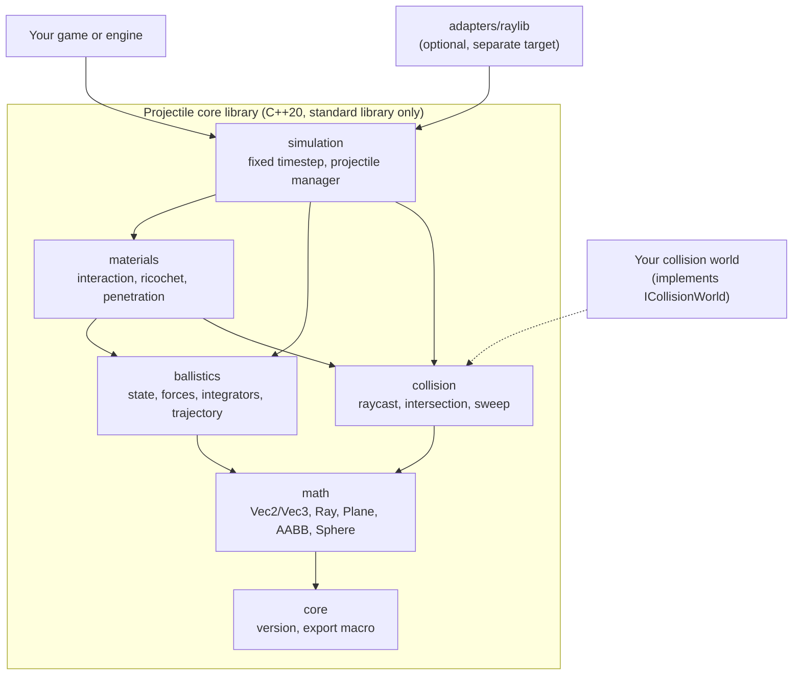

# Projectile

Projectile is an engine-independent C++20 library for real-time projectile simulation: hitscan
and ray queries, ballistic motion under gravity, drag and wind, trajectory prediction, swept
collision, and configurable material interactions such as ricochet and penetration. It depends
only on the C++ standard library. It plugs into your engine through small interfaces instead
of owning your scene.

> **Status: pre-alpha, Milestone 2 of 7.** In place so far:
> - the build, packaging, test and CI foundation;
> - the math module: vectors, rays, segments, planes, spheres, boxes and triangles;
> - the collision module: ray and segment intersection, and the collision-world interface.
>
> The simulation features marked as planned below are **not implemented yet**.

## Feature roadmap

| Feature | Release | Status |
|---|---|---|
| Vector and mathematical utilities | v0.1 | Done (Milestone 1) |
| Ray and geometric intersection | v0.1 | Done (Milestone 2) |
| Hitscan queries | v0.1 | Done (Milestone 2) |
| Projectile integration (semi-implicit Euler, RK4) | v0.1 | Planned (Milestone 3) |
| Gravity and trajectory prediction | v0.1 | Planned (Milestone 3) |
| Fixed-timestep simulation | v0.1 | Planned (Milestone 4) |
| Swept sphere collision | v0.2 | Planned (Milestone 4) |
| Wind and aerodynamic drag | v0.2 | Planned (Milestone 5) |
| Material interaction interface | v0.2 | Planned (Milestone 5) |
| Ricochet and penetration | v0.3 | Planned (Milestone 5) |
| raylib visualization adapter and demos | v0.3 | Planned (Milestone 6) |
| Benchmark suite | v0.3 | Planned (Milestone 6) |
| Single-header distribution | v1.0 | Optional |

Material interactions are configurable gameplay approximations. They are not validated
real-world penetration models.

## Architecture

The planned module layering is shown below. Arrows point from a module to the modules it uses.
`core`, `math` and `collision` exist today.



## Requirements

- **Compiler with C++20:** GCC 12+, Clang 16+, MSVC 2022 (19.30+), or AppleClang 15+.
- **CMake 3.20+.** The presets in `CMakePresets.json` need CMake 3.21+.
- **Ninja** is recommended but not required. Any CMake generator works.

The library never downloads anything. Only the test suite has a dependency, Catch2 v3. It uses an
installed Catch2 3 if one is found; otherwise it downloads the pinned v3.16.1 release, which is
verified by SHA-256.

CI builds and tests these configurations:

| Platform | Compiler | Generator | Library |
|---|---|---|---|
| Ubuntu 24.04 | GCC 12, GCC 14, Clang 16 | Ninja | static |
| Ubuntu 24.04 | Clang 18 | Ninja | shared |
| Ubuntu 24.04 | GCC 12 with CMake 3.20 (no presets) | Unix Makefiles | static |
| Windows Server 2022 | MSVC 2022 | Visual Studio 17 2022 | static and shared |
| macOS 15 | AppleClang | Unix Makefiles | static |

There are also AddressSanitizer + UndefinedBehaviorSanitizer runs with GCC 14 and Clang 18, a
clang-tidy run and a clang-format check.

## Building

```sh
export CMAKE_GENERATOR=Ninja   # optional; omit it to use CMake's default generator

cmake --preset dev             # configure: Debug, tests, warnings as errors
cmake --build --preset dev     # build
ctest --preset dev             # run the tests
```

| Preset | Build type | Tests | Notes |
|---|---|---|---|
| `debug` | Debug | yes | |
| `release` | Release | no | the library only |
| `release-tests` | Release | yes | what CI runs |
| `sanitize` | Debug | yes | ASan, LSan and UBSan; GCC or Clang; not on Windows |
| `dev` | Debug | yes | warnings as errors |

Each preset builds into `build/<preset>`. Pass `-B <dir>` when configuring to use another
directory, for example to keep GCC and Clang builds side by side.

Without presets, CMake 3.20 is enough:

```sh
cmake -S . -B build -DCMAKE_BUILD_TYPE=Release
cmake --build build
ctest --test-dir build --output-on-failure
```

### Options

| Option | Default | Description |
|---|---|---|
| `PROJECTILE_BUILD_TESTS` | ON at top level | Build the test suite. This fetches Catch2 3 if it is not installed. |
| `PROJECTILE_INSTALL` | ON at top level | Generate install rules and the `find_package` package. |
| `PROJECTILE_WARNINGS_AS_ERRORS` | OFF | Treat warnings in Projectile's own targets as errors. |
| `PROJECTILE_ENABLE_CLANG_TIDY` | OFF | Run clang-tidy on Projectile's sources while building (Ninja and Makefile generators). |
| `BUILD_SHARED_LIBS` | OFF | Build a shared library instead of a static one. |

"Top level" means Projectile is the project being built. When another project embeds it through
`add_subdirectory` or `FetchContent`, the tests and install rules are off unless that project
turns them on. Projectile's warning flags never propagate to consumers.

## Using Projectile in your project

### Installed package

```sh
cmake --preset release
cmake --build --preset release
cmake --install build/release --prefix /path/to/prefix
```

```cmake
find_package(Projectile 0.1 CONFIG REQUIRED)   # configure with -DCMAKE_PREFIX_PATH=/path/to/prefix
target_link_libraries(my_game PRIVATE Projectile::Projectile)
```

Before 1.0, minor releases may break compatibility, so `find_package(Projectile 0.1)` accepts only
0.1.x releases.

### FetchContent or add_subdirectory

```cmake
include(FetchContent)
FetchContent_Declare(
    Projectile
    GIT_REPOSITORY <repository-url>
    GIT_TAG        <release-tag>
)
FetchContent_MakeAvailable(Projectile)

target_link_libraries(my_game PRIVATE Projectile::Projectile)
```

`add_subdirectory(path/to/projectile)` works the same way. Linking `Projectile::Projectile`
provides the include paths and the C++20 requirement.

### Shared library on Windows

Windows finds DLLs next to the executable or on `PATH`. When Projectile is built as a shared
library, copy it next to your program:

```cmake
add_custom_command(TARGET my_game POST_BUILD
    COMMAND ${CMAKE_COMMAND} -E copy_if_different
            $<TARGET_FILE:Projectile::Projectile> $<TARGET_FILE_DIR:my_game>)
```

### Troubleshooting: `CMAKE_CXX_COMPILER_CLANG_SCAN_DEPS-NOTFOUND`

Linking `Projectile::Projectile` makes your target C++20. With CMake 3.28 or newer, CMake then
scans C++20 sources for module imports. With Clang, that scan needs `clang-scan-deps`, which
some distributions package separately (on Ubuntu, `clang-tools-NN`). If your project does not
use C++20 modules, turn the scan off instead:

```cmake
set_target_properties(my_game PROPERTIES CXX_SCAN_FOR_MODULES OFF)
# or, for every target in a directory: set(CMAKE_CXX_SCAN_FOR_MODULES OFF)
```

### Quick start

The projectile simulation API arrives with Milestone 3. Today you can run hitscan queries
against the geometric primitives:

```cpp
#include <projectile/projectile.hpp>

#include <cstdio>
#include <optional>

using namespace projectile;

int main() {
    // A shot from a muzzle 1.5 m above the ground. make_ray() normalizes the direction, and
    // returns std::nullopt if there is none (zero length, NaN or infinity).
    const std::optional<Ray> shot = make_ray(Vec3{0.0, 1.5, 0.0}, Vec3{40.0, -1.0, 3.0});
    if (!shot) {
        return 1;
    }

    // Hitscan against a target within 100 m.
    const Sphere target{.center = {20.0, 1.0, 1.5}, .radius = 0.5};
    if (const std::optional<HitResult> hit = intersect(*shot, target, 100.0)) {
        std::printf("target hit after %.2f m\n", hit->distance);
        // The normal faces the shooter, so reflecting off it gives the ricochet direction.
        const Vec3 ricochet = reflect(shot->direction, hit->normal);
        std::printf("ricochet: {%.2f, %.2f, %.2f}\n", ricochet.x, ricochet.y, ricochet.z);
    }

    // Where would the shot reach the ground plane y = 0?
    const Plane ground{.normal = {0.0, 1.0, 0.0}, .distance = 0.0};
    if (const std::optional<HitResult> hit = intersect(*shot, ground)) {
        std::printf("ground reached after %.1f m\n", hit->distance);
    }
}
```

All quantities are in SI units, and angles are in radians. See
[docs/mathematics.md](docs/mathematics.md) for the mathematical conventions, and
[docs/collision.md](docs/collision.md) for the query conventions: what a hit reports, front and
back faces, and boundary and degenerate cases. To query your game's own geometry, implement
`ICollisionWorld` and call `raycast(world, ray, max_distance)`; `docs/collision.md` has a complete
example.

### Checking the library version

To detect headers and a library from different releases, compare the version your program was
compiled against with the version of the library it linked:

```cpp
#include <projectile/projectile.hpp>

#include <cstdio>

int main() {
    // PROJECTILE_VERSION_STRING is the version of the headers you compiled against;
    // projectile::version() and version_string() describe the library you linked.
    const projectile::Version headers{
        .major = PROJECTILE_VERSION_MAJOR,
        .minor = PROJECTILE_VERSION_MINOR,
        .patch = PROJECTILE_VERSION_PATCH,
    };
    if (projectile::version() != headers) {
        std::fprintf(stderr, "Projectile headers and library do not match\n");
        return 1;
    }

    const auto linked = projectile::version_string();
    std::printf("Projectile %.*s\n", static_cast<int>(linked.size()), linked.data());
}
```

## Tests

`ctest --preset dev` runs the whole suite. Tests carry labels:

- `unit`: Catch2 unit tests. These include property tests that check mathematical properties on
  10,000 random inputs each. CTest pins the random seed, so every run checks the same inputs; to
  explore other inputs, run `build/dev/bin/projectile_unit_tests "[property]" --rng-seed random`.
- `package`: installs the library into a staging prefix, then configures, builds and runs a
  small downstream project with `find_package(Projectile)` and with `add_subdirectory`. These
  take a few seconds; skip them with `ctest --preset dev -LE package`.

During the build, every public header is also compiled on its own, which proves that each
header is self-contained.

## Contributing

See [CONTRIBUTING.md](CONTRIBUTING.md) for the development workflow, coding conventions, the
definition of done and the release process.

## License

Projectile is released under the [MIT License](LICENSE).
